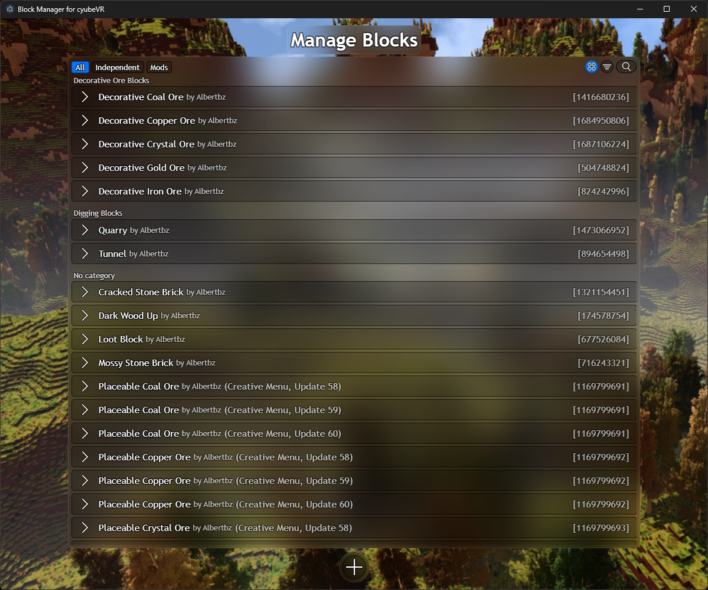
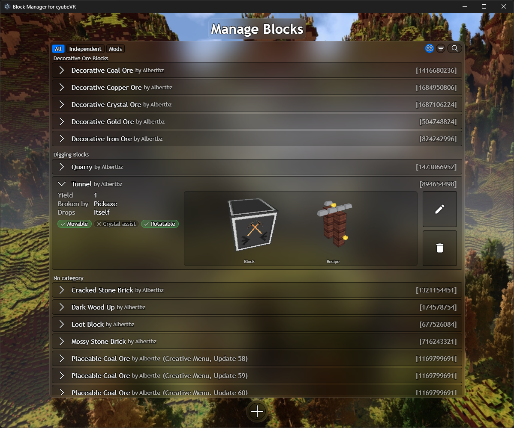
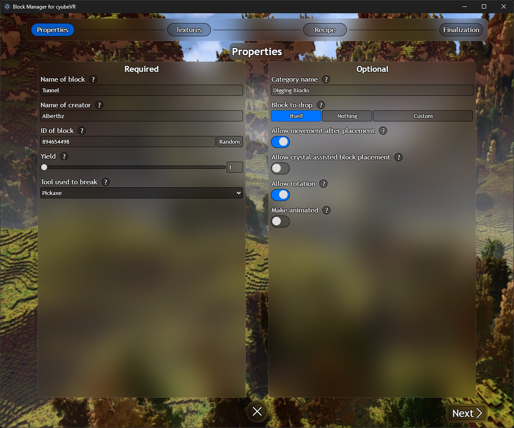
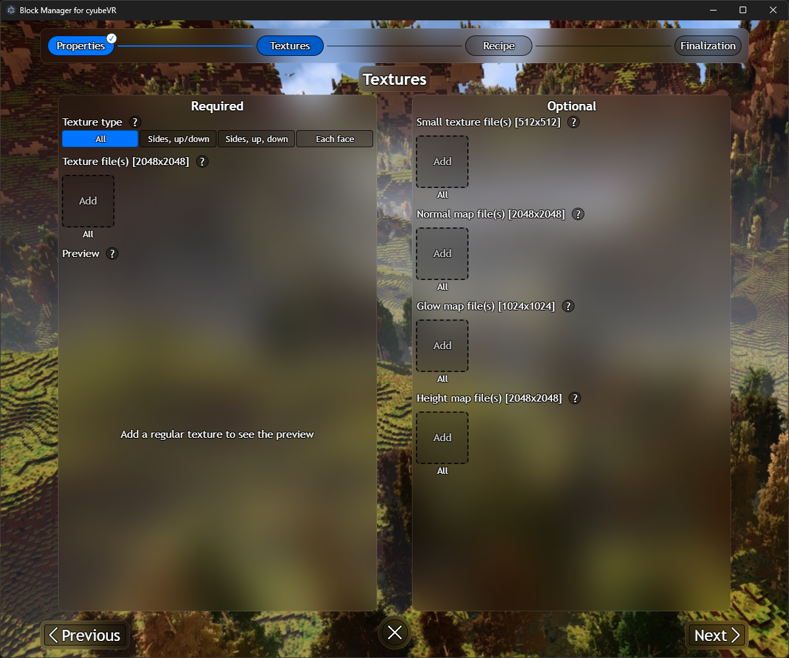
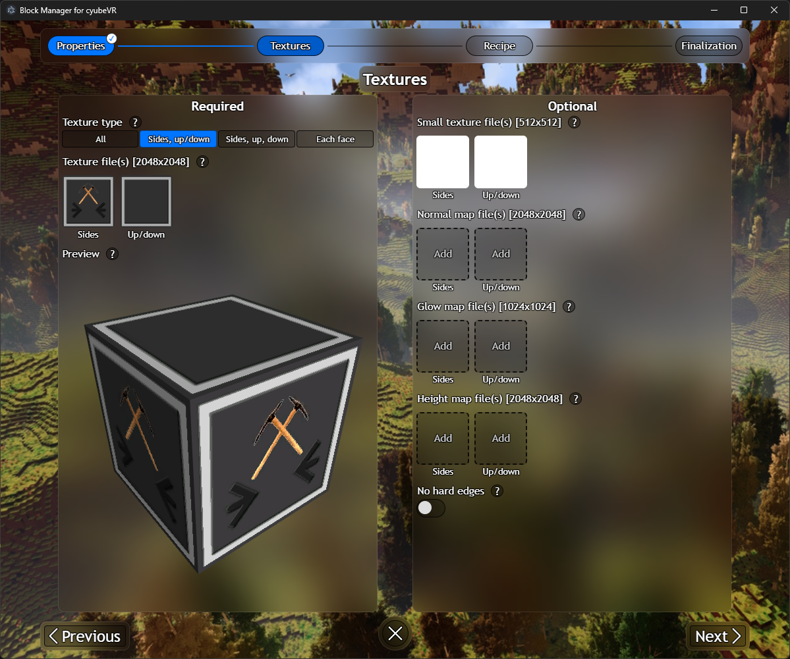
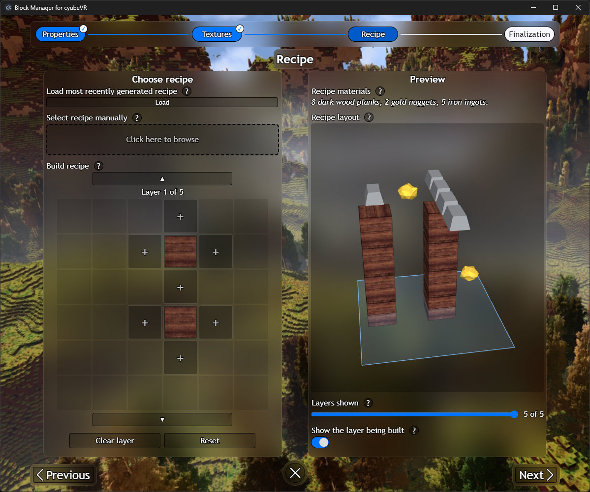
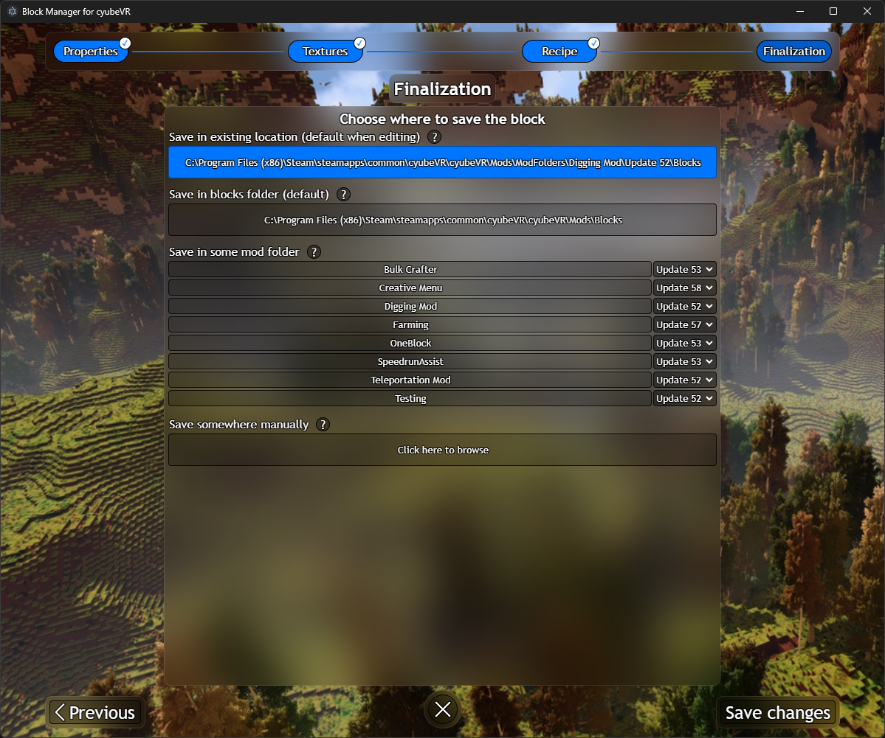

# BlockManager
This application can be used to manage all of your cyubeVR custom blocks, as well as easily create new ones when given some textures.

# How to use
There are two main parts of the application - the "Manage Blocks" window and the "Block Generator" window. When starting the application 
you will be greeted with the first of the two.
## Manage Blocks window
If you have never made any custom blocks, then you will not see much here. In my case, because I have made quite a few custom blocks, it looks
like this:

Here you can see an overview of the names, creators and IDs of the blocks, grouped by their category. Blocks that are part of a mod also
show the name of the mod and the game version it is for. If you click any of them you will be able to expand their view, where you
can see more detailed information about the block, as well as a preview of both the block and its recipe. Clicking a preview shows it larger.
You can also choose to edit, duplicate or delete the block with the buttons to the right:

At the top you can filter by all blocks, independent blocks or blocks from mods (and then choose the game version), turn the grouping by
category on or off, sort by name, ID or when the block was created, and search for a block by name. The application remembers which blocks you had open and which
filter you chose.

If you ever edit a block then it will just open the Block Generator window with all values already there, and then you can just save 
the changes by going to the Finalization step. Duplicating a block works the same way, except that it is saved as a new block,
keeping the original.

Additionally, to open the Block Generator window to create a new custom block, click the + button at the bottom.

## Block Generator window
Next up we have the Block Generator window. This is where you will create new blocks from scratch using some textures that
you have made, as well as specify the recipe and all other details.

Block generation is split up into four steps: Properties, Textures, Recipe and Finalization. Use the Previous and Next buttons to move
between them, or click a step in the bar at the top to go straight to it. If you have changed anything, you will be asked before the block is
discarded when pressing the X button at the bottom. Let's go through each of the steps.
### Properties
Here you have to fill out the properties of the block that you want to make. This means the name of the block, your name, an ID,
and much more. It looks like this:

There are both Required and Optional properties. To read more about each of them, simply hover over the question mark next to
each field.

Among the optional properties is "Allow rotation", which is enabled by default. Disable it for blocks that should never be
placed rotated, such as blocks with a fixed direction (like a compass) or blocks whose textures would tile incorrectly when rotated.

### Textures
The textures part is pretty self-explanatory. First choose the texture type, which decides which faces of the block get their own texture:
the same texture for all faces, one for the sides and one for both up and down, one for the sides, up and down each, or one for each of the
six faces. Every kind of texture then has a slot for each of them. It looks like this when no textures have been selected:

Click a slot or drop files on it to add a texture, drag a texture to another slot to move it there, and click the cross in a texture's corner to
remove it. A preview of the block is made automatically whenever the textures change, and you can click it to see it larger. It looks like
this when textures have been given for the sides and for up/down:

Here there are also both Required and Optional textures that you can provide. Hover over the question mark to read more about
each type of texture.

Textures can be given as .png, .jpg or .dds files. If a .dds file already has the right size, format and mipmaps for its texture
type, it is used as it is, without being compressed again. This is useful if you want full control over the compression. Any other
.dds file is converted like a regular image. The formats are:

| Texture type | Size | Format |
| --- | --- | --- |
| Texture | 2048x2048 | BC3 (DXT5) |
| Small texture | 512x512 | BC3 (DXT5) |
| Normal map | 2048x2048 | BC5 (ATI2) |
| Glow map | 1024x1024 | BC1 (DXT1) |
| Height map | 2048x2048 | BC4 (ATI1) |

One of the optional texture types is height maps. If you provide a height map for every texture, the block will have tessellation,
giving its surface actual 3D depth in game, which is also shown in the preview. Height maps should be greyscale 2048x2048 images, where
brighter means higher.

When the block has more than one texture, the "No hard edges" option is shown. Enable it if the textures are painted to continue into
each other where they meet, like a top whose border runs on into the sides. The height maps then continue around the edges of the block.
Otherwise, they flatten out toward the edges between different textures.

### Recipe
For the recipe there are three ways to choose what blocks to use:
- If you use the in-game recipe generator button, then you can simply press the "Load" button under "Load most recently generated recipe".
- You can select a recipe file generated by the game manually.
- You can build the recipe yourself in the recipe builder, one layer at a time, seen from above. Click a square with a + to put a material
there, or a filled square to change it, and right-click a filled square to remove it. Use the arrows or scroll to change layer. A recipe
that has been loaded can also be changed here.

To the right you can see the materials that the recipe needs, as well as a 3D preview of how they are put together. Drag to turn it around,
scroll to zoom, and point at a block to see what it is. The "Layers shown" slider lets you look at the layers inside the recipe. If no recipe
is chosen, the block will not be craftable, which is useful for blocks in a VoxelAPI mod that should only be placed by the mod.

The recipe part looks like this:

### Finalization
Lastly we have the finalization. This is just where you specify where to save the block - you can either save it as an independent
block, as part of a mod, or somewhere you choose manually. When editing a block, it is saved in its existing location by default. Below,
previews of the block and its recipe show what you are about to save. It looks like this:

If you want the block to be part of a mod, then choose the mod and the version that the mod is made for.
